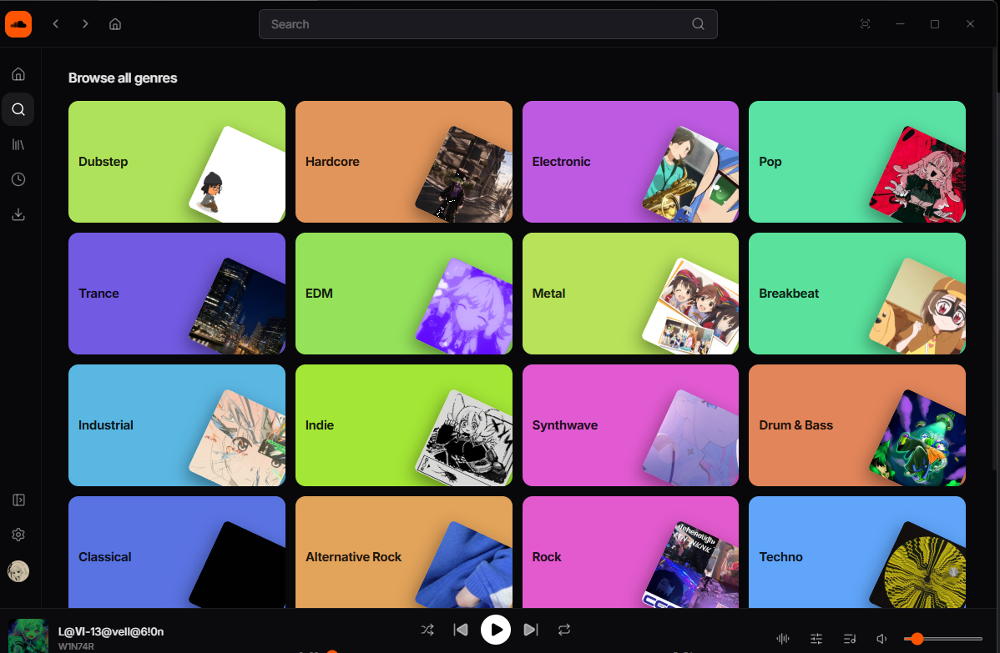
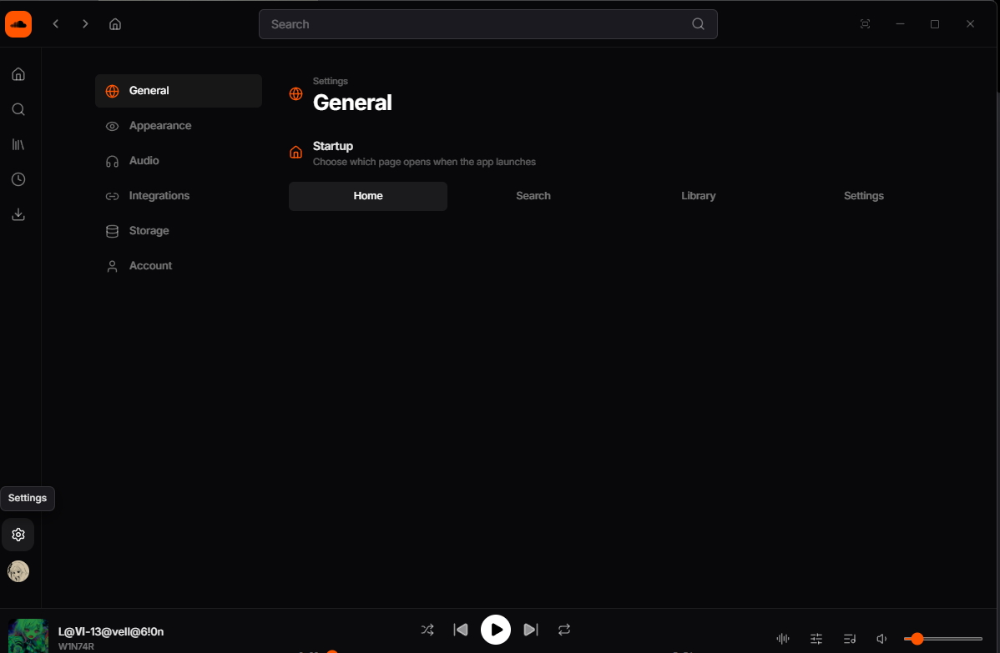
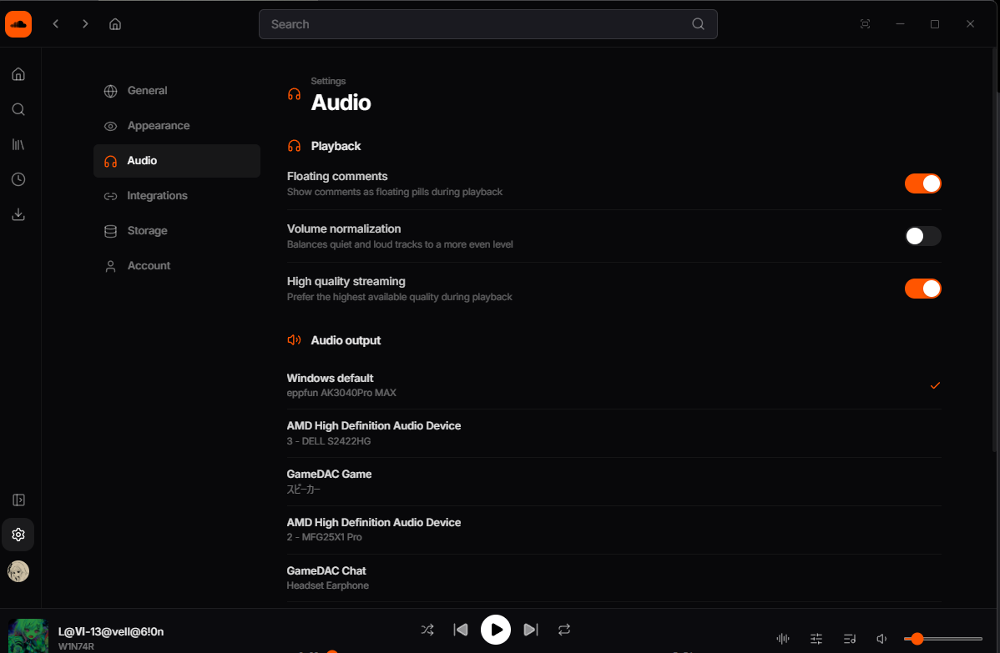

<p align="center">
<a href="https://github.com/Jomvet-lovers/soundcloud-desktop/releases/latest">

</a>
</p>
<h1 align="center">SoundCloud Desktop</h1>

<p align="center">
<a href="README.md">English</a> | <a href="README.ja.md">日本語</a>
</p>

<p align="center">
<a href="https://github.com/Jomvet-lovers/soundcloud-desktop/releases/latest">

</a>
<a href="https://github.com/Jomvet-lovers/soundcloud-desktop/releases">

</a>
</p>

> [!WARNING]
> **個人利用を目的とした非公式クライアントです。自己責任でご利用ください。**
> 登録・認可された SoundCloud API クライアントではなく、Web プレイヤーと同様の方法で
> SoundCloud と通信します。利用はご自身の判断で行ってください。
> このクライアントを利用して発生した問題について、作者・関係者は責任を負いません。

> 本リポジトリは
> [SoundCloud-Desktop](https://github.com/zxcloli666/SoundCloud-Desktop)
> （[@zxcloli666](https://github.com/zxcloli666) 氏、MIT ライセンス）を元にした
> 独立した改造版です。

## スクリーンショット








## 機能

公式・フォーク元の機能を引き継ぎつつ、より洗練されたUIとUXを提供します。

- ダウンロード
  - M4A (AAC) / MP3 (320 kbps) / FLAC / WAV
  のファイルとして保存可能。
- オフライン再生
   - いいねしたトラックをまとめてキャッシュ（「Download all likes」）
     または 1 曲ずつ保存し、ネットワークなしで再生できます。
   - キャッシュされた楽曲には容量制限が設けられており、手動での管理は必要ありません。
      - デフォルトは1GBまでですが、Setting > Storageから任意の容量に設定可能です。
- フィード
   - フォロー中のアーティストの新着・リポストを新しい順に表示
- 検索
   - トラック
   - プレイリスト
   - ユーザー
   - アルバム
- ライブラリ
   - いいねしたトラック
   - プレイリスト
   - フォロー一覧
   - フォローフィード

## サインイン

ログイン画面で「Sign in with SoundCloud」を押すと、アプリ内ウィンドウで
soundcloud.com が開きます。

そこでサインインするとセッションが自動的に取得され、
アプリのデータディレクトリにローカル保存されます。

SoundCloud 以外に送信されることはありません。

## アプリのデータデータディレクトリ (保存先)

- Windows
   - `%LOCALAPPDATA%\fun.natsumi.scd.direct`

## ビルド

必要環境（Windows）: Rust (MSVC)、VS Build Tools、CMake、NASM、LLVM (libclang)、
Node 20+

```sh
cd desktop
corepack pnpm install
corepack pnpm tauri dev     # 開発（Vite HMR）
corepack pnpm tauri build --bundles nsis   # リリース＋NSISインストーラー
```

## クレジット / ライセンス

[zxcloli666/SoundCloud-Desktop](https://github.com/zxcloli666/SoundCloud-Desktop) を
元にしています。MIT ライセンス — [LICENSE](LICENSE) を参照。
